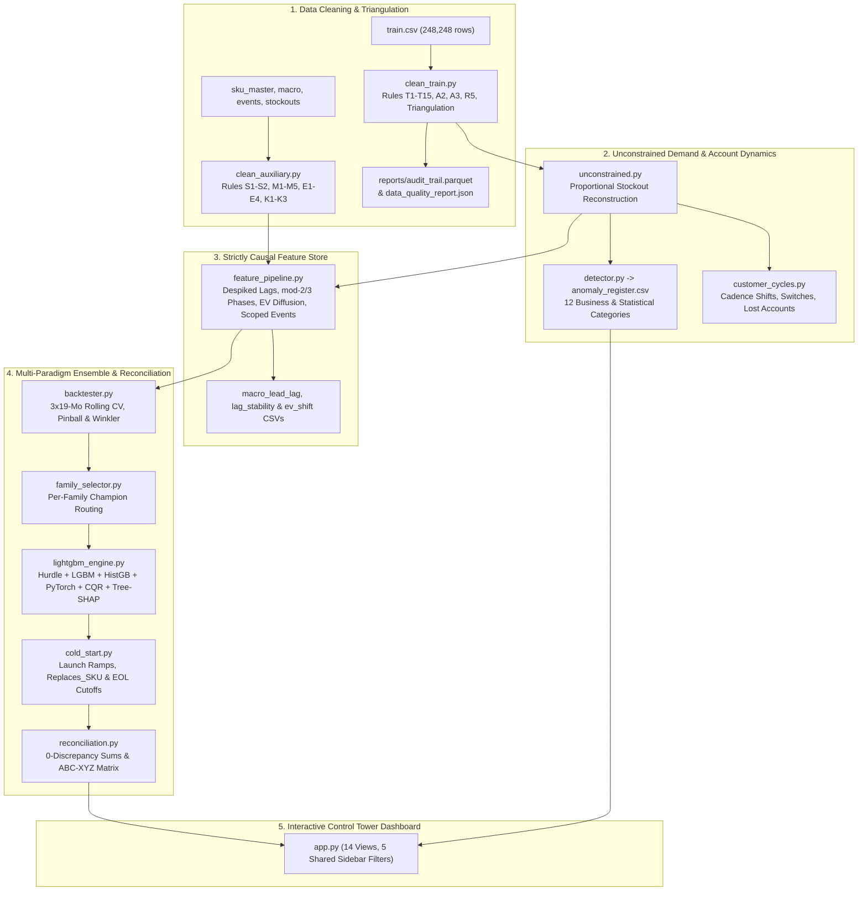

# Celeris Automobili Industrial: Demand Forecasting & Planning Control Tower
### MKS AIML Hackathon — Phase 2: End-to-End Demand Forecasting & S&OP Solution

[](https://www.python.org/)
[](https://lightgbm.readthedocs.io/)
[](https://pytorch.org/)
[](https://streamlit.io/)
[](https://docs.pytest.org/)
[](#)

---

## Executive Summary

**Celeris Automobili Industrial** is a Tier-1 multinational automotive and industrial component manufacturer supplying OEMs and distributors across **601 catalog SKUs (595 forecast SKUs), 7 product families, 4 sales channels, and 6 global regions** (North America, Europe, Asia Pacific, India, Latin America, Middle East & Africa).

This repository implements an end-to-end **Demand Forecasting Pipeline and 14-View Interactive Planning Control Tower** for Phase 2 of the MKS AIML Hackathon:
- **Exact Arithmetic & Currency Triangulation (`Units * Price = Revenue`)**: Standardizes dates, deduplicates on latest `Load_Timestamp`, consolidates all `12` tier-1 customers (`2,455` raw aliases/typos cleaned), and repairs `10x`/`100x` unit typos (`368` rows), cents-scaled prices (`614`), decimal shifts (`385`), and EUR conversions (`498`) while preserving valid H2-2022 `6%` surcharges (`EV-027`).
- **Unconstrained Demand & Anomaly Intelligence**: Reconstructs true customer request volume from inventory stockouts (`1,200` stockout anomalies among `3,793` categorized events across `12` anomaly categories), logs master-data contradictions (`reports/master_data_contradictions.csv`), and detects temporal Rule-6 customer cadence shifts (`102` transitions).
- **Causal Multi-Horizon Feature Store**: Builds origin-frozen (`Date <= origin`) spike-despiked levels, bi-monthly (`mod-2`) and quarterly (`mod-3`) ordering-cycle phases, Empirical Bayes seasonal shrinkage, and logistic-diffusion EV saturation elasticities without lookahead leakage.
- **Multi-Paradigm ML & Deep Learning Ensemble**: Combines **6 heterogeneous learners** via out-of-sample SLSQP WAPE+Bias optimization with calibrated zero-gating (`tau=0.10`), Horizon-Stratified Scaled Conformal Quantiles (`P10`/`P50`/`P90`), native Tree-SHAP attributions, exact `0`-discrepancy hierarchy reconciliation, and ABC-XYZ Newsvendor working-capital sizing.

---

## Key Performance Benchmarks

### 1. Rolling-Origin 19-Month Backtest Tournament ([`outputs/backtest_metrics.csv`](outputs/backtest_metrics.csv))

Evaluated strictly without future leakage across three 19-month rolling origins (`2023-10`, `2024-10`, and `2025-03` Holdout):

| Origin | Evaluation Window | Seasonal Naive WAPE | HistGB Poisson WAPE | PyTorch Entity-ResNet WAPE | Hurdle Two-Stage WAPE | **Hybrid Ensemble WAPE** | **Ensemble Bias** | **CQR Coverage (80% Target)** | **Avg Pinball Loss** |
|:---:|:---:|:---:|:---:|:---:|:---:|:---:|:---:|:---:|:---:|
| **2023-10** | 2023-11 → 2025-05 | 41.81% | 31.37% | 32.06% | 31.80% | **31.09%** | -8.58% | **85.3%** | 4.93 |
| **2024-10** | 2024-11 → 2026-05 | 38.75% | 30.27% | 29.69% | 30.14% | **29.50%** | -3.94% | **83.1%** | 4.47 |
| **2025-03** *(Holdout)* | 2025-04 → 2026-10 | 39.64% | 29.96% | 31.70% | 29.69% | **29.76%** | +3.95% | **81.0%** | 4.49 |

- **All 7/7 Product Families** select the **Hybrid Ensemble** over Statistical Baselines (`27.67%`–`33.83%` Holdout WAPE across families in [`outputs/family_model_selection.csv`](outputs/family_model_selection.csv)).
- **19-Month Horizon Continuity (`2025-03`)**: Month 1 WAPE `26.94%`, Month 2 WAPE `26.20%`, and Month 19 WAPE **`28.08%`** (`Bias +1.44%`, Coverage `81.2%`), eliminating horizon-13+ lag collapse.
- **Competition Submission Summary**: **`2,640,501` P50 units** (`P10: 1,784,912`, `P90: 3,653,707`) across **`58,219` rows** (`$2.246B` USD projected 19-month revenue), with exact **`0` unit discrepancy** across Business Unit, Product Family, and Region totals.

---

## System Architecture



---

## Key Technical Capabilities

### Workstream 1: Data Cleaning & Integrity
- **Triangulated Price & Unit Repair (`clean_train.py`)**: Cross-checks `Units * Price = Revenue` per line against annual SKU median USD prices (`Rule T12/T13`), cleanly separating real volume surges and valid `EV-027` surcharges from `10x`/`100x` unit typos, cents entries, decimal shifts, and EUR invoices.
- **Full Entity Standardization**: Standardizes dates (`2062 -> 2026` transposition fix), deduplicates `Record_ID` by latest `Load_Timestamp`, canonicalizes all `12` tier-1 customers (`2,455` variants), enforces `sku_master` Product Family/Business Unit consistency, and zeroes Rule-5 pre-launch/post-EOL violations.

### Workstream 2: Anomalies, Stockouts & Account Dynamics
- **Unconstrained Demand Recovery (`unconstrained.py`)**: Reconstructs lost demand from `inventory_stockouts.csv` across matching `(Date, SKU_ID, Region)` customer lines.
- **12-Category Anomaly Register (`detector.py`)**: Separates `Stockout Constrained`, `COVID-19`, `Chip Shortage`, `2022 Inflation & Surcharge`, `ERP Migration`, `MEA Opening`, `Early Buying (Pre-Price Hike)`, `European Summer Dip`, `Nexon Strike`, `Red Sea Logistics`, `Helios Line 2 Expansion`, and statistical spikes.
- **Ordering-Cycle Shifts (`customer_cycles.py`)**: Tracks customer-SKU arrival cadences and pre-2023 vs post-2023 temporal cadence transitions (`reports/cadence_changes.csv`), switches, and dormant accounts.

### Workstream 3: Causal Feature Store & Drivers
- **Zero-Leakage Rolling Snapshots (`feature_pipeline.py`)**: Freezes trailing windows, same-calendar-month Empirical Bayes seasonality, causal spike-despiked levels (`clean_ewm`), and ordering-phase indicators (`ym_mod2_nz_rate`, `ym_mod3_nz_rate`, `same_month_nz_rate`) strictly `<= origin_date`.
- **EV Logistic-Diffusion & Macro Lead/Lag (`ev_transition.py`, `macro_drivers.py`)**: Models EV demand scaling via `exp(0.042 * delta_EV)` anchored at origin with saturation headroom and 12-month adoption velocity alongside macro lead/lag stability checks.
- **Scoped Calendar Events (`calendar_events.py`)**: Maps `EV-001`..`EV-068` accurately by `Scope_Type` (`Global`, `Region`, `Product_Family`, `Channel`, `Customer|Region`) and `Start_Date..End_Date`, including open-ended `EV-052` and forecast-window `EV-062`.

### Workstream 4: Multi-Paradigm Ensemble & Optimization
- **Six-Learner Hybrid Architecture (`lightgbm_engine.py`)**:
  1. Two-Stage Zero-Inflated Hurdle (`LGBMClassifier * Positive LGBM Tweedie`)
  2. LightGBM Tweedie Regressor (`p=1.25`)
  3. LightGBM Multiplicative Log-Ratio Residual (`log1p(y) - log1p(anchor)`)
  4. Scikit-Learn `HistGradientBoostingRegressor` (`loss="poisson"`)
  5. PyTorch `TabularDemandResNet` with entity embeddings across `SKU_ID` and categorical attributes
  6. Empirical Bayes Structural Anchor
- **SLSQP Meta-Blending & Scaled CQR**: Fits L2-regularized simplex weights and conservative Hurdle cutoff `tau` on a strict zero-overlap temporal holdout, and calibrates `[P10, P90]` bounds per horizon band (`1–6m`, `7–12m`, `13–19m`) targeting ~80% empirical coverage with strict monotonicity ($0 \le P10 \le P50 \le P90$).
- **Explainability & ABC-XYZ Optimization**: Exports row-level Tree-SHAP attributions (`outputs/forecast_drivers.parquet`) and segments SKUs across the 9-cell ABC×XYZ matrix (`outputs/abc_xyz_inventory.csv`).

---

## Interactive Planning Control Tower Dashboard (14 Views)

Built in Streamlit and Plotly sharing all **5 global sidebar filters** (`Product Family`, `SKU ID`, `Sales Region`, `Sales Channel`, `Tier-1 Customer`):

1. **Executive Overview** *(Required)*: Continuous Units and USD Revenue timelines (2019–2028) with P10/P50/P90 uncertainty ribbons, mix breakdowns, and headline KPIs.
2. **Data Health & Audit** *(Required)*: Before vs after file cleaning tables, issue counts by type, master-data contradictions, and searchable row-level audit log.
3. **Demand Explorer** *(Required)*: Interactive 4-level hierarchy sunburst (`BU -> Family -> Region -> Customer`), seasonality heatmaps, zero-month histograms, and ADI-CV² quadrant scatter.
4. **Anomaly Monitor** *(Required)*: Time-series anomaly scatter across all 12 event categories plus customer switch and dormant-account tabs.
5. **Forecast & Accuracy** *(Required)*: Forecast vs History chart, 9-model multi-origin leaderboard (`WAPE`, `Bias`, `Pinball`, `CQR Coverage`), and Family/Region/Horizon accuracy breakdowns.
6. **AI Explainability (Tree-SHAP)** *(Additional)*: 6-driver Tree-SHAP waterfall chart decomposition across portfolio and filtered SKUs.
7. **ABC-XYZ Inventory Optimizer** *(Additional)*: 9-cell Revenue Tier × Variability heatmap and Newsvendor safety-stock & working-capital allocation.
8. **Macro Lead/Lag Heatmap** *(Optional 1)*: Cross-correlation heatmap across lags 0–12 and pre/post-2022 stability checks.
9. **What-If Scenario Simulator** *(Optional 2)*: Interactive controls for PMI shocks, raw material inflation, EV acceleration, Export shocks, and Pre-Hike elasticity.
10. **Procurement & Safety Stock** *(Optional 3)*: P90 buffer procurement quantities and supplier planning views.
11. **Lifecycle & Transition** *(Optional 4)*: EOL cutoffs, commercial launches, and `Replaces_SKU` ramp-up handoffs.
12. **Stockouts & Lost Sales** *(Optional 5)*: Fill rates, unfulfilled volume, and shortage root-cause breakdown.
13. **Planner Exception Center** *(Optional 6)*: Prioritized queue for high-uncertainty SKUs, imminent EOLs, and cadence alerts.
14. **Data Export & Reports** *(Optional 7)*: Downloads for `submission.csv`, `abc_xyz_inventory.csv`, `master_data_contradictions.csv`, `anomaly_register.csv`, `data_quality_report.json`, and `model_card.md`.

---

## Quickstart Guide

### 1. Environment Setup

```bash
git clone https://github.com/pkprajapati7402/mks-hackathon.git
cd mks-hackathon
pip install -r requirements.txt
```

### 2. Run the Full End-to-End Pipeline

```bash
python run_pipeline.py
```

### 3. Launch the Interactive Control Tower Dashboard

```bash
streamlit run app.py
```

### 4. Run the Automated Test Suite

```bash
python -m pytest -v tests/
```

---

## Repository Structure

```text
mks-hackathon/
├── student_data/                    # Raw ERP extracts (input datasets)
├── data/
│   ├── cleaned/                     # Cleaned parquet and csv tables
│   └── features/                    # Causal panel feature store parquets
├── outputs/
│   ├── submission.csv               # 58,219-row competition submission
│   ├── forecast_intervals.parquet   # P10, P50, P90 predictions & USD revenue
│   ├── forecast_drivers.parquet     # Tree-SHAP 6-driver attributions
│   ├── abc_xyz_inventory.csv        # ABC-XYZ Newsvendor working-capital plan
│   ├── backtest_metrics.csv         # 9-model multi-origin WAPE, Bias, Pinball, CQR
│   ├── backtest_breakdowns.csv      # Family, Region, Horizon 1-19 accuracy splits
│   ├── family_model_selection.csv   # Champion model routing per Product Family
│   └── hierarchical_reconciliation.csv
├── reports/                         # DQ audits, anomaly register, cycles, Model Card
├── scripts/
│   └── build_notebook.py            # Reproducible generator for Colab notebook
├── src/
│   ├── config.py
│   ├── audit.py
│   ├── reports_generator.py
│   ├── cleaning/
│   ├── anomalies/
│   ├── features/
│   ├── models/
│   └── dashboard/                   # 14 Streamlit views + shared theme & charts
├── tests/                           # Pytest suite (10 unit & compliance tests)
├── mks_datathon_notebook.ipynb      # End-to-end Google Colab & local notebook
├── app.py                           # Root Streamlit dashboard entrypoint
├── run_pipeline.py                  # One-command CLI master runner
└── submission.csv                   # Competition submission copy (58,219 rows)
```

---

## Compliance Checklist

- [x] **Exact Row Count & Keys**: `submission.csv` contains **58,219 rows** matching `student_data/test.csv`.
- [x] **Format & Validity**: `Date, SKU_ID, Region, Units_Sold_Forecast` with non-negative integers and zero nulls.
- [x] **Exact Reconciliation**: Zero discrepancy (`Delta = 0`) across SKU, Product Family, Business Unit, Region, and Global totals.
- [x] **Catalog Lifecycle & Unconstrained Target**: Respects `Launch_Date`, `EOL_Date`, and `Replaces_SKU`; forecasts true unconstrained customer demand.
- [x] **Automated Verification**: `10/10` `pytest` tests and all `14` Streamlit views verified cleanly.
