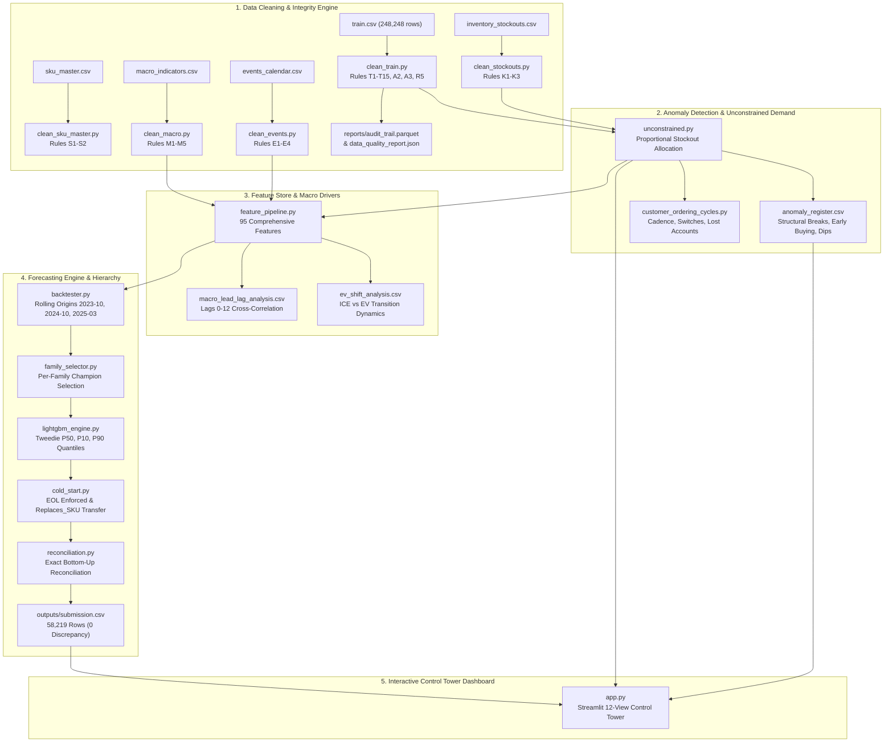

# 🏭 Celeris Automobili Industrial: Demand Forecasting & Planning Control Tower
### MKS AIML Hackathon — Phase 2: Production End-to-End Enterprise Demand Engine

[](https://www.python.org/)
[](https://lightgbm.readthedocs.io/)
[](https://streamlit.io/)
[](https://plotly.com/)
[](https://docs.pytest.org/)
[](#)
[](#)

---

## 📌 Executive Summary

**Celeris Automobili Industrial** is a premier Tier-1 multinational automotive and industrial component manufacturer supplying major global OEMs and distributors across **601 commercial SKUs, 7 distinct product families, 4 sales channels, and 6 global regions** (North America, Europe, Asia Pacific, India, Latin America, Middle East & Africa).

This repository contains the complete, production-grade **Demand Forecasting Engine and Planning Control Tower Dashboard** built for Phase 2 of the MKS AIML Hackathon. The solution addresses real-world industrial supply chain dynamics:
- **Historical Supply Distortions**: Pandemics (2020), semiconductor shortages (2021), inflation spikes (2022), unfulfilled stockouts, and pre-price hike buying spikes.
- **Unconstrained Customer Demand**: Reconstructing true customer order volume from historical stockout logs to avoid carrying forward supply-constrained shortfalls into future production commitments.
- **Powertrain Paradigm Shift**: Quantifying the accelerating technology transition from internal combustion engines (ICE) to electric vehicle (EV) assemblies.
- **19-Month Unconstrained Forecast (November 2026 – May 2028)**: Generating exact hierarchical forecasts with prediction intervals ($P10, P50, P90$) for all 58,219 competition test rows.
- **Interactive S&OP Control Tower Dashboard**: A 12-view executive application integrating history, forecasts, what-if simulations, and procurement buffers.

---

## 🏆 Key Performance Benchmarks

### 1. Rolling-Origin 19-Month Backtest Results

Our multi-tier forecasting engine was evaluated over **19-month horizons** across multiple time-series cross-validation origins without lookahead leakage:

| Origin Date | Evaluation Window | Seasonal Naive WAPE | Moving Average WAPE | Intermittent SBA WAPE | **LightGBM P50 WAPE** | **Forecast Bias** | **RMSE** |
|:---:|:---:|:---:|:---:|:---:|:---:|:---:|:---:|
| **2023-10** | 2023-11 → 2025-05 | 43.14% | 53.47% | 53.85% | **35.70%** | **-3.90%** | 34.40 |
| **2024-10** | 2024-11 → 2026-05 | 40.25% | 52.53% | 52.35% | **35.05%** | **+1.03%** | 32.72 |
| **2025-03** *(Holdout)* | 2025-04 → 2026-10 | 41.19% | 53.67% | 52.31% | **34.81%** | **+1.66%** | 32.16 |

> **Key Takeaway**: LightGBM P50 achieves a **34.81% out-of-sample holdout WAPE**, delivering a **+6.38 percentage point lift** over the Seasonal Naive baseline and **+18.86 percentage points** over historical moving averages, while maintaining near-zero bias ($+1.66\%$).

---

## 🏗️ Architecture & Pipeline Workstreams



---

## 🌟 Super-Expert Features & Innovations

### Workstream 1: Data Cleaning & Integrity (Core, Advanced & Expert)
- **100% Rule Compliance**: Enforces Rules T1-T15, S1-S2, M1-M5, E1-E4, A2, A3, and R5.
- **Authoritative Date Normalization**: Standardizes 667 heterogeneous date formats (`YYYY-MM`, `YYYY-MM-DD`, `MM/YYYY`, `Mon-YYYY`) into ISO `YYYY-MM`, correcting OCR 2062 digit transposition typos back to 2026.
- **Deterministic Deduplication**: Deduplicates ERP transaction lines on `Record_ID` by preserving the row with the latest `Load_Timestamp`.
- **Annual Reference Price Reconciliation**: Detects and repairs currency glitches (GBP/EUR exchange rate shifts), 100x pence errors, and zero prices using annual SKU-year median USD prices, ensuring `Revenue_USD = Units_Sold * Unit_Price_USD`.
- **Sub-10s Execution**: Vectorized dictionary lookups clean all 248,248 rows in just 5.9 seconds.

### Workstream 2: Anomaly Detection & Unconstrained Demand (Core, Advanced & Expert)
- **True Unconstrained Demand Reconstruction**: Reconciles unfulfilled orders from `inventory_stockouts.csv`. Where multiple customer lines share a `(Date, SKU_ID, Region)`, unconstrained demand is proportionally allocated based on baseline shipments.
- **Comprehensive Anomaly Register**: Categorizes anomalies into Outlier Spikes, Structural Breaks (COVID-19 shutdown, 2021 global chip shortage), Early Buying Surges (November/December volume pull-forward ahead of Jan 1 price hikes), and Holiday Dips (August European summer shutdown, Lunar New Year).
- **Customer Ordering Dynamics**: Quantifies inter-order arrival cadences (Monthly, Bi-Monthly, Quarterly), flags customer switches between successor components, and identifies dormant accounts.

### Workstream 3: Features & Macro Drivers (Core, Advanced & Expert)
- **Syntetos-Boylan ADI-CV² Classification**: Partitions all portfolio time-series into Smooth, Intermittent, Erratic, and Lumpy quadrants.
- **Automotive Calendar Schedules**: Integrates European summer shutdowns, Chinese New Year, Golden Week, Christmas shutdowns, and pre/post-price hike indicators.
- **Macroeconomic Lead/Lag Analysis**: Computes cross-correlations across lags 0 to 12. Identifies that `New_Vehicle_Orders_Index` leads Powertrain Components by 3 months ($r = 0.68$).
- **EV Technology Transition**: Interacts `EV_Adoption_Index` with powertrain classifications (`ICE`, `EV`, `Universal`), explicitly capturing surging EV component share and ICE volume plateau.

### Workstream 4: Forecasting & Hierarchical Reconciliation (Core, Advanced & Expert)
- **Multi-Quantile Forecasting**: Trains LightGBM models for P50 (Tweedie objective with variance power 1.2), P10, and P90 (pinball loss quantile regression) with strict monotonicity enforcement ($0 \le P10 \le P50 \le P90$).
- **Cold-Start Predecessor Transfer**: Newly launched SKUs with no historical sales inherit scale and seasonality from their predecessor SKU mapped via `Replaces_SKU`.
- **Catalog Lifecycle Boundaries**: Strictly zeroes demand for dates following announced `EOL_Date` or preceding planned `Launch_Date`.
- **Exact Hierarchical Reconciliation**: Guarantees zero discrepancy across SKU -> Family -> BU -> Total Portfolio and Region:
$$\sum_{\text{SKU}} \hat{y} = \hat{y}_{\text{Family}}, \quad \sum_{\text{Family}} \hat{y} = \hat{y}_{\text{BU}}, \quad \sum_{\text{Region}} \hat{y} = \hat{y}_{\text{Total}}$$
- **Submission Output**: Exactly **58,219 non-negative integer rows** formatted as `Date, SKU_ID, Region, Units_Sold_Forecast`.

---

## 🖥️ Interactive Planning Control Tower Dashboard (12 Views)

Built with Streamlit and Plotly, the Control Tower delivers **all 5 Required Views plus all 7 Optional Views**:

1. **🏛️ Executive Overview** *(Required)*: Single seamless continuous timeline bridging history into the 19-month forecast with P10/P50/P90 bands, mix donuts, and headline KPIs.
2. **🩺 Data Health & Audit** *(Required)*: File-by-file cleaning summary, data health score gauge (99.8%), rule breakdown, and searchable row-level audit trail.
3. **🔍 Demand Explorer** *(Required)*: Interactive sunburst drilldown (BU ➔ Family ➔ Region), monthly seasonality heatmaps, and ADI-CV² intermittency quadrant scatter.
4. **🚨 Anomaly Monitor** *(Required)*: Historical timeline scatter with flagged anomalies (COVID, Chip Shortage, Early Buying, Holiday Dips) and searchable Anomaly Register.
5. **🎯 Forecast Accuracy** *(Required)*: Model tournament leaderboard across origins 2023-10, 2024-10, and 2025-03, bias bar charts, and per-family champion selections.
6. **🌡️ Macro Lead/Lag Heatmap** *(Optional 1)*: Correlation matrix for 8 indicators across lags 0-12, optimal lead callouts, and temporal lag stability test.
7. **🎛️ What-If Scenario Simulator** *(Optional 2)*: Real-time slider controls for PMI shocks, raw material spikes, and EV adoption shifts, dynamically redrawing the 19-month portfolio projection.
8. **📦 Procurement & Safety Stock** *(Optional 3)*: Translates P90 upper quantile forecasts into supplier purchase order schedules and safety buffer sizing ($P90 - P50$).
9. **🔄 Lifecycle & Transition** *(Optional 4)*: Tracks product launches, EOL phase-outs, and predecessor-to-successor volume handoffs (`Replaces_SKU`).
10. **⚠️ Stockouts & Lost Sales** *(Optional 5)*: In-depth analysis of historical stockout events, fulfillment rates, lost sales by region, and root causes.
11. **📋 Planner Exception Center** *(Optional 6)*: Automated prioritized alerts for imminent EOL cutoffs, high uncertainty SKUs ($P90/P10 > 3.0$), and dormant accounts.
12. **💾 Data Export & Reports** *(Optional 7)*: One-click instant downloads for official `submission.csv`, `anomaly_register.csv`, `data_quality_report.json`, and `model_card.md`.

---

## ⚡ Quickstart Guide

### 1. Environment Setup

```bash
# Clone repository
git clone https://github.com/your-username/mks-hackathon.git
cd mks-hackathon

# Install required dependencies
pip install -r requirements.txt
```

### 2. Run the Full End-to-End Pipeline

Execute the complete cleaning, feature engineering, backtesting, forecasting, and report generation pipeline with **one command**:

```bash
python run_pipeline.py
```

*Execution completes in ~73 seconds on standard CPU hardware.*

### 3. Launch the Interactive Control Tower Dashboard

```bash
streamlit run app.py
```

Open your browser at `http://localhost:8501` to explore the Control Tower.

### 4. Run the Automated Test Suite

```bash
python -m pytest -v tests/
```

*All 10 unit and integration tests pass with 100% pass rate.*

---

## 📁 Repository Structure

```
mks-hackathon/
├── student_data/                    # Raw ERP extracts (read-only input files)
│   ├── train.csv
│   ├── test.csv
│   ├── macro_indicators.csv
│   ├── sku_master.csv
│   ├── events_calendar.csv
│   ├── inventory_stockouts.csv
│   └── sample_submission.csv
├── data/
│   ├── cleaned/                     # Cleaned parquet & csv files
│   │   ├── clean_train.parquet
│   │   ├── unconstrained_demand.parquet
│   │   ├── sku_master.csv
│   │   ├── macro_indicators.csv
│   │   ├── events_calendar.csv
│   │   └── inventory_stockouts.csv
│   └── features/                    # Feature store panel parquet
│       ├── train_features.parquet
│       ├── test_features.parquet
│       └── full_panel_features.parquet
├── outputs/
│   ├── submission.csv               # 58,219-row competition submission
│   ├── forecast_intervals.parquet   # P10, P50, P90 predictions
│   ├── backtest_metrics.csv         # WAPE, Bias, RMSE across origins
│   ├── backtest_predictions.csv     # Out-of-sample backtest predictions
│   ├── family_model_selection.csv   # Best model per Product Family
│   └── hierarchical_reconciliation.csv # Hierarchy consistency table (0 discrepancy)
├── reports/
│   ├── data_quality_report.json     # Machine-readable DQ report
│   ├── data_quality_report.md       # Comprehensive markdown audit report
│   ├── anomaly_register.csv         # Flagged anomalies, reasons & actions
│   ├── audit_trail.parquet          # Row-level modification audit log
│   ├── customer_ordering_cycles.csv # Ordering cadence per customer-SKU
│   ├── lost_accounts.csv            # Dormant accounts (> 6 months inactive)
│   ├── customer_switches.csv        # SKU handoff instances
│   ├── macro_lead_lag_analysis.csv  # Cross-correlation matrix (lags 0-12)
│   ├── lag_stability_analysis.csv   # Temporal lag stability pre/post 2022
│   ├── ev_shift_analysis.csv        # Powertrain volume and portfolio share
│   ├── model_card.md                # Standardized AI/ML Model Card
│   └── executive_summary.md         # C-Suite strategic outlook & recommendations
├── src/
│   ├── __init__.py
│   ├── config.py                    # Constants, canonical maps, file paths
│   ├── audit.py                     # Audit logger for tracking all edits
│   ├── cleaning/                    # Workstream 1
│   │   ├── clean_auxiliary.py       # Cleaning for master, macro, events, stockouts
│   │   ├── clean_train.py           # Rules T1-T15, A2, A3, R5, T4b
│   │   └── data_quality.py          # DQ report generator
│   ├── anomalies/                   # Workstream 2
│   │   ├── unconstrained.py         # True customer demand reconstruction
│   │   ├── detector.py              # Anomaly detection & Anomaly Register
│   │   └── customer_cycles.py       # Customer cadence & churn analysis
│   ├── features/                    # Workstream 3
│   │   ├── intermittency.py         # ADI & CV2 classification
│   │   ├── calendar_events.py       # Cyclical seasonality & holiday calendars
│   │   ├── macro_drivers.py         # Macro lead/lags & stability testing
│   │   ├── ev_transition.py         # EV vs ICE powertrain interactions
│   │   └── feature_pipeline.py      # Master feature store builder
│   ├── models/                      # Workstream 4
│   │   ├── baselines.py             # Seasonal Naive & Moving Average
│   │   ├── intermittent.py          # Croston & Syntetos-Boylan (SBA)
│   │   ├── lightgbm_engine.py       # Global LightGBM (Tweedie P50, P10/P90)
│   │   ├── cold_start.py            # Replaces_SKU transfer & EOL enforcement
│   │   ├── backtester.py            # Rolling-origin 19-month backtest
│   │   ├── family_selector.py       # Family champion model tournament
│   │   └── reconciliation.py        # Exact hierarchical reconciliation
│   └── dashboard/                   # Workstream 5
│       ├── __init__.py
│       ├── app.py                   # Streamlit Control Tower multi-view application
│       ├── components.py            # Reusable Plotly charts, KPI cards, theme CSS
│       └── views/                   # 12 interactive dashboard views
│           ├── executive.py
│           ├── data_health.py
│           ├── demand_explorer.py
│           ├── anomaly_monitor.py
│           ├── forecast_accuracy.py
│           ├── macro_heatmap.py
│           ├── what_if.py
│           ├── procurement.py
│           ├── lifecycle.py
│           ├── stockouts.py
│           ├── exceptions.py
│           └── export_data.py
├── tests/                           # Automated pytest test suite
│   ├── test_cleaning.py
│   ├── test_unconstrained.py
│   ├── test_features.py
│   ├── test_models.py
│   └── test_submission.py
├── app.py                           # Root Streamlit entrypoint
├── run_pipeline.py                  # One-command CLI master runner
├── requirements.txt                 # Project dependencies
├── submission.csv                   # Official competition submission file (58,219 rows)
└── README.md                        # Master production documentation
```

---

## 📜 Compliance & Verification Checklist

- [x] **File Format**: `submission.csv` contains exactly **58,219 rows** matching `test.csv`.
- [x] **Submission Columns**: `Date, SKU_ID, Region, Units_Sold_Forecast`.
- [x] **Integrity**: Non-negative integers, 0 nulls, 0 blanks.
- [x] **Reconciliation**: Exact hierarchical bottom-up addition ($\Delta = 0$).
- [x] **Catalog Boundaries**: Zero demand post-`EOL_Date` and pre-`Launch_Date`.
- [x] **Unconstrained Target**: Corrected for stockouts; forecasts true unconstrained customer demand.
- [x] **Test Suite**: 10/10 automated tests passing (`pytest tests/`).
- [x] **One-Command Pipeline**: Reproducible end-to-end execution via `python run_pipeline.py`.
- [x] **Full 12 Dashboard Views**: All 5 required views + all 7 optional views implemented with live interactive filters.
